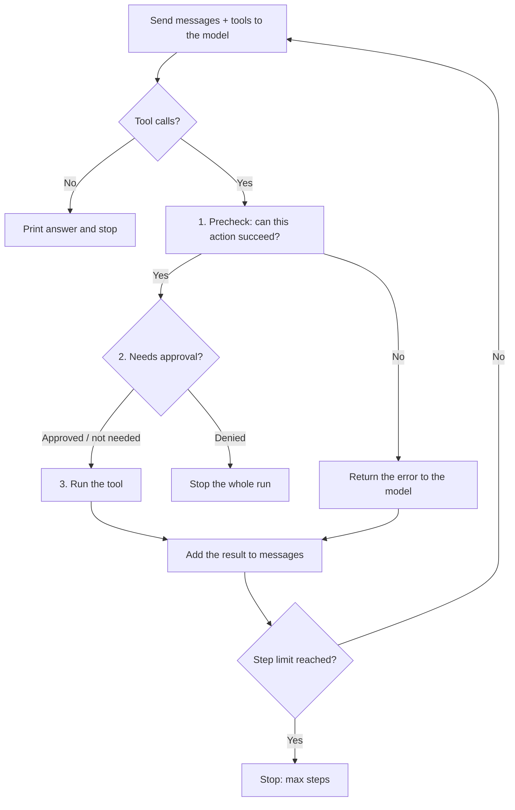

# llm-basics: a hand-built coding agent

A small AI agent written from scratch in Python. No agent framework, just a `while` loop, a local LLM and a set of tools. It can check the weather, do math, and work like a mini coding agent: list, read, write and edit files in a sandbox folder, then run Python to check its own work.

> **Status:** learning project (Stage 4 of my Agentic AI learning path). Not meant for production use.

## Why

Frameworks like LangChain hide the agent loop behind abstractions. I wanted to build the loop myself first, so I understand what every framework is doing underneath: how the model asks for a tool, how results go back, and what can go wrong in between.

Every guardrail in this project was added after I saw the agent fail without it.

## Quick start

**Requirements:** Windows / macOS / Linux, [uv](https://docs.astral.sh/uv/), [Ollama](https://ollama.com/)

```bash
# 1. Download the local model
ollama pull qwen3:8b

# 2. Clone the repo and install dependencies
git clone https://github.com/Kho10-16/llm-basics.git
cd llm-basics
uv sync

# 3. Make sure Ollama is running, then start the agent
uv run weather_agent.py
```

The user request is set in `main()` (the `"role": "user"` message). Change it to try different tasks, for example:

```text
Run buggy.py. If there is an error, fix it, then run it again to confirm it works.
```

## Tools

| Tool | What it does | Needs approval |
|---|---|---|
| `get_weather` | Current temperature from the Open-Meteo API | No |
| `calculate` | One arithmetic operation (`+ - * /`) | No |
| `list_files` | Lists the sandbox folder (folders end with `/`) | No |
| `read_file` | Reads a file in the sandbox | No |
| `write_file` | Writes a whole file in the sandbox | **Yes** |
| `edit_file` | Replaces one exact piece of text in a file | **Yes** |
| `run_command` | Runs `python ...` inside the sandbox | **Yes** |

Rule of thumb: tools that only **look** run freely; tools that **change** something need a human "yes".

## Harness design

### The loop



The order **check → ask → run** matters: an action that is going to fail never reaches the human, so I'm only asked to approve edits the model has actually read and that will succeed.

### Guardrails

| Guardrail | How | Why |
|---|---|---|
| Step limit | `MAX_STEPS = 10` | Stops the agent from looping forever |
| Retry with backoff | `chat_with_retry` and `get_weather` retry temporary failures (connection errors, HTTP 429/5xx) with exponential backoff + jitter | Temporary problems fix themselves; permanent ones should fail fast |
| Context cleanup | `clear_old_tool_results` replaces old tool outputs with a short placeholder | Old results fill the context window and cost tokens on every step |
| Sandbox | Every path is `resolve()`d and must stay inside `sandbox/` | Stops `../` tricks from reaching other files |
| Read before edit | `edit_file` refuses files that `read_file` hasn't read in this run | Without it, the model edited files blindly by guessing their content |
| Exactly-once edits | `old_str` must appear exactly once in the file | If it matches 0 or many places, the edit is ambiguous |
| Command allowlist | `run_command` only allows `python`, with no shell (`&&`, `>` are just text) | An allowlist only lets in what I expect; a blocklist misses what I didn't think of |
| Timeout + truncation | Commands stop after 10 s; output is cut at 2,000 characters | Infinite loops can't hang the agent, and huge outputs can't flood the context |
| Human approval | `write_file`, `edit_file`, `run_command` ask `y/n` first | The last line of defense for anything that changes the system |
| Stop on denial | Saying `n` ends the run immediately | The model can't "ask the user" in this program, and it kept retrying denied actions |

### Error handling

Errors are sorted into three kinds, and each is handled differently:

1. **Temporary environment problem** (network drop, server busy) → retry with backoff
2. **The model's request was wrong** (bad path, unread file, wrong `old_str`, infinite loop) → return a clear error message that says how to fix it, so the model can correct itself
3. **Permission problem** (the human said no) → stop and hand control back to the human

A script that crashes is **not** a tool error: `run_command` still returns the exit code and traceback, because the model needs them to fix the code.

## What I learned

- **The model copies docstring examples.** It used the example coordinates from `get_weather`, and the example filename `notes.txt` from `edit_file`, instead of finding the real values.
- **Prompts are suggestions, not rules.** "Read the file before editing" and "Do not retry" in text were both ignored. The fixes that worked were in code: a read-before-edit check and stopping on denial.
- **The model misreads why it was stopped.** After a denial, it assumed it had skipped a step, read the file, and proposed the exact same edit again.
- **Model behaviour changes between runs.** The same request sometimes started with `list_files`, sometimes with `edit_file` directly. Important rules belong in code.
- **Overly general prompt rules leak.** "Always state units" (meant for weather) made the model report an average as `2.5°C`.
- **Every wasted step costs tokens.** Blocking a doomed edit before it reached me cut one task from about 7,000 to about 5,400 input tokens.

## Limitations

- **The sandbox is not real isolation.** Only `python` is allowed, but a Python script can still touch files outside `sandbox/`. Human approval is the real defense here; proper isolation would need a container or VM.
- **One request per run.** The user message is hard-coded and the program ends after one answer. There is no chat loop yet.
- **Read history is per run.** `READ_FILES` lives in memory and resets every time the program starts.
- **Windows paths:** commands are split with `shlex`, which drops backslashes, so paths must use `/`.
- **Small local model.** `qwen3:8b` sometimes ignores instructions that a larger model would follow.

## References

- Anthropic, [Building Effective Agents](https://www.anthropic.com/engineering/building-effective-agents)
- Thorsten Ball, [How to Build an Agent](https://ampcode.com/notes/how-to-build-an-agent)
- Anthropic docs: [Bash tool](https://platform.claude.com/docs/en/agents-and-tools/tool-use/bash-tool), [Text editor tool](https://platform.claude.com/docs/en/agents-and-tools/tool-use/text-editor-tool)

## Author

Kho Chien Young, Software Engineering student at Curtin University Malaysia